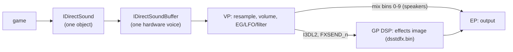

# Xbox DirectSound: PC와 다른 점, 구조체, 상수, ADPCM, 믹스 빈, 효과 이미지

Xbox의 DirectSound(`DSOUND`)는 타이틀에 정적 링크되고 MCPX APU를 직접 다룬다. APU는 음성 처리기(VP, 하드웨어 음성 256개 중 3D 64개)와 두 DSP(GP: 효과, EP: 출력·AC3 인코드)로 이루어진다. 아래는 공개 XDK 문서 지식과 우리 바이너리의 lift 본문에서 왔다. 바이너리에서 확인한 것은 **확인됨**으로 표시하고 근거는 [analysis: DSOUND](../analysis/dsound.md)에 둔다.

Xbox DirectSound (`DSOUND`) is statically linked into each title and drives the MCPX APU directly. The APU is a voice processor (VP: 256 hardware voices, 64 of them 3D) and two DSPs (GP: effects; EP: output and AC3 encoding). The content below comes from public XDK documentation knowledge and the lifted bodies in our binary; what was confirmed on the binary is marked **confirmed**, with the evidence in [analysis: DSOUND](../analysis/dsound.md).

## 1. PC DirectSound와 다른 점 / Differences from PC DirectSound

| 항목 / Item | Xbox |
|---|---|
| 호출 / Calls | C 함수 `IDirectSound_X(pThis, …)`, `IDirectSoundBuffer_X(pThis, …)`(stdcall). C++ 메서드는 이것을 부르는 인라인. 내부 C++ 객체는 인터페이스 포인터 − 8(DirectSound), − 0x1C(버퍼) **확인됨** / C functions; the C++ methods are inlines over them; the internal objects sit at interface − 8 and − 0x1C (**confirmed**) |
| `SetCooperativeLevel`, `Compact` | 아무것도 하지 않음(`xor eax,eax; ret n`) **확인됨** / do nothing (**confirmed**) |
| `Unlock` | 아무것도 하지 않음 **확인됨**. 버퍼 메모리는 APU가 DMA로 직접 읽으므로, 게임은 재생 중에도 그 메모리에 바로 쓴다 / does nothing (**confirmed**); the APU reads buffer memory by DMA, so titles write into it while it plays |
| `SetBufferData(p, n)` | 버퍼가 게임 메모리를 직접 재생 / the buffer plays the caller's memory |
| `DirectSoundDoWork()` | 라이브러리의 주기 작업(알림, 스트림 패킷) / the library's periodic work |
| 팬 / Pan | 없음. 대신 믹스 빈별 볼륨 / none; per-mix-bin volumes instead |
| 3D | 버퍼마다 HRTF 또는 I3DL2. `DS3D_DEFERRED` 설정은 `CommitDeferredSettings`로 적용 / per-buffer HRTF or I3DL2; deferred settings apply on `CommitDeferredSettings` |

## 2. 구조체 / Structures

| 구조체 / Structure | 레이아웃 / Layout |
|---|---|
| `DSBUFFERDESC` (0x18) | `dwSize` +0, `dwFlags` +4, `dwBufferBytes` +8, `lpwfxFormat` +0xC, `lpMixBins` +0x10, `dwInputMixBin` +0x14 (**확인됨 / confirmed**) |
| `WAVEFORMATEX` | `wFormatTag` +0, `nChannels` +2, `nSamplesPerSec` +4, `nAvgBytesPerSec` +8, `nBlockAlign` +0xC, `wBitsPerSample` +0xE, `cbSize` +0x10 (**확인됨 / confirmed**). Xbox ADPCM은 `cbSize` 2 뒤에 `wSamplesPerBlock`(64) |
| `DSMIXBINS` | `dwMixBinCount` +0, `lpMixBinVolumePairs` +4 (**확인됨**); 쌍 `{DWORD dwMixBin; LONG lVolume}` 8바이트 / 8-byte pairs |
| `DSCAPS` | `dwFree2DBuffers`, `dwFree3DBuffers`, `dwFreeBufferSGEs`, `dwMemoryAllocated` |
| `DSEFFECTIMAGEDESC` | `dwEffectCount` +0, `dwTotalScratchSize` +4, `aEffectMaps[]` +8 (**확인됨**) |
| `DSEFFECTMAPDESC` (0x20) | `lpvCodeSegment`, `dwCodeSize`, `lpvStateSegment`, `dwStateSize`, `lpvYMemorySegment`, `dwYMemorySize`, `lpvScratchSegment`, `dwScratchSize` (상태 포인터 +8 **확인됨** / state pointer at +8 confirmed) |

## 3. 상수 / Constants

| 이름 / Name | 값 / Value |
|---|---|
| `DSBCAPS_CTRL3D` / `CTRLFREQUENCY` / `CTRLVOLUME` | 0x10 / 0x20 / 0x80 |
| `DSBCAPS_MIXIN` / `DSBCAPS_FXIN` | 0x2000 / 0x80000 (원본 `Stop`이 `0x82000`으로 검사, **확인됨** / tested together by the original `Stop`) |
| `DSBCAPS_LOCDEFER` | 0x40000 |
| `DSBPLAY_LOOPING` / `FROMSTART` / `SYNCHPLAYBACK` | 1 / 2 / 4 (1, 2 **확인됨**) |
| `DSBLOCK_FROMWRITECURSOR` / `ENTIREBUFFER` | 1 / 2 (**확인됨**) |
| `DSBSTATUS_PLAYING` / `PAUSED` / `LOOPING` | 1 / 2 / 4 (1, 5 **확인됨**) |
| `DSBVOLUME_MIN` / `MAX` | −10000 / 0 (1/100 dB) |
| `DSSPEAKER_STEREO` / `MONO` / `SURROUND`, `ENABLE_AC3` / `DTS` | 0 / 1 / 2, 0x10000 / 0x20000 (`XC_AUDIO_FLAGS`와 같은 배치 / same layout as `XC_AUDIO_FLAGS`) |
| `WAVE_FORMAT_PCM` / `WAVE_FORMAT_XBOX_ADPCM` | 1 / 0x69 |
| `DSERR_INVALIDCALL` | 0x88780032 (**확인됨**) |

믹스 빈 / Mix bins (`DSMIXBIN_*`): 0 FRONT_LEFT, 1 FRONT_RIGHT, 2 FRONT_CENTER, 3 LOW_FREQUENCY, 4 BACK_LEFT, 5 BACK_RIGHT, 6–9 XTLK_FRONT_LEFT/RIGHT, XTLK_BACK_LEFT/RIGHT(HRTF 크로스토크 제거 출력 / crosstalk-cancelled HRTF outputs), 10 I3DL2(리버브 송신 / reverb send), 11–30 FXSEND_0…19(GP 효과 입력 / GP effect inputs). 한 음성은 최대 8쌍. 다채널 음성의 쌍은 채널에 차례로 붙는다 / a voice takes up to eight pairs, assigned to a multichannel voice's channels in turn.

## 4. Xbox ADPCM

* IMA ADPCM의 변형. 채널마다 36바이트 블록: 헤더 4바이트(`int16` 시작 표본, `uint8` 단계 색인 0–88, 예약 1바이트), 뒤로 니블 64개(32바이트)가 채널별 4바이트(8표본) 묶음으로 교대하고, 바이트 안에서는 낮은 니블이 먼저다. `nBlockAlign` = 36 × 채널.
* 디코드하면 블록당 65표본(헤더 + 니블 64개, xbadpcm의 36 → 130바이트)이 나오지만 XDK의 `wSamplesPerBlock`은 64다. reJSRF는 블록당 64표본(헤더 + 앞 니블 63개)을 재생한다(**추정**).
* A variant of IMA ADPCM. Per channel, a 36-byte block: a 4-byte header (`int16` starting sample, `uint8` step index 0–88, one reserved byte), then 64 nibbles (32 bytes) with channels alternating in 4-byte (8-sample) groups, low nibble first within a byte; `nBlockAlign` = 36 × channels. Decoding yields 65 samples per block (header plus 64 nibbles; xbadpcm's 36 → 130 bytes), but the XDK's `wSamplesPerBlock` is 64; reJSRF plays 64 samples per block (header plus the first 63 nibbles) (**inferred**).

## 5. 효과 이미지 / Effects image

* XDK의 `dsstdfx.bin`(표준 효과: I3DL2 리버브, 필터, 지연 등)은 GP DSP 프로그램이다. 게임이 파일을 읽어 `IDirectSound_DownloadEffectsImage`에 넘기면 라이브러리가 DSP에 올리고 `DSEFFECTIMAGEDESC`를 돌려준다. 이후 `GetEffectData`/`SetEffectData(effect, offset, …)`로 효과 상태(DSP X 메모리)를 읽고 쓴다.
* 파일 배치(**확인됨**): `+0x800`에 헤더 6 DWORD(`+0x804` 코드 워드 수, `+0x80C` 상태(X) 워드 수), 본문은 `+0x818`부터 코드 → 상태, 그 뒤에 평문 효과 표(`DSEFFECTIMAGEDESC`와 같은 모양, 포인터 자리는 이미지 오프셋, 스크래치는 0xC000 기준), 끝에 효과별 8바이트 키. 코드 구간만 암호화되어 있다.
* The XDK's `dsstdfx.bin` (the standard effects: I3DL2 reverb, filters, delays and others) is a GP DSP program. A title reads the file and passes it to `IDirectSound_DownloadEffectsImage`, which loads it into the DSP and returns a `DSEFFECTIMAGEDESC`; `GetEffectData`/`SetEffectData(effect, offset, …)` then read and write effect state (DSP X memory). File layout (**confirmed**): six header DWORDs at `+0x800` (`+0x804` code words, `+0x80C` state (X) words); the body from `+0x818`, code then state; then the plaintext effect table (shaped like `DSEFFECTIMAGEDESC`, with image offsets in the pointer slots and scratch offsets based at 0xC000); then an 8-byte key per effect. Only the code region is encrypted.
