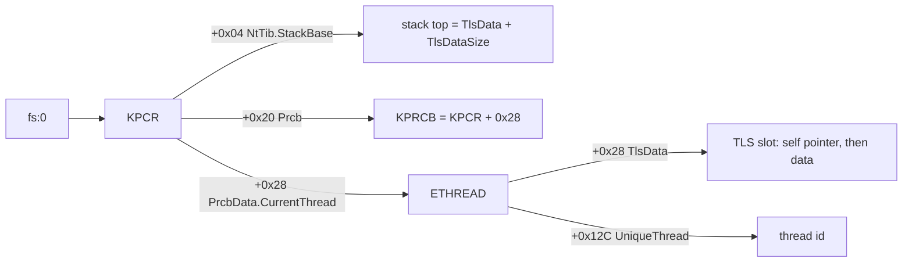

# Xbox 커널 구조와 서비스

커널 HLE(`src/rexbox/hle/kernel/`)가 게스트 메모리에 재현하는 구조와 그 근거를 모은다. "게임 코드로 확인"은 JSRF US 빌드의 디스어셈블이나 실행에서 직접 본 것이고, 나머지는 외부 자료에서 왔다.

출처: [xboxdevwiki: Kernel](https://xboxdevwiki.net/Kernel), [xboxdevwiki: Xbox Partitions](https://xboxdevwiki.net/Xbox_Partitions), [nxdk xboxkrnl 헤더](https://github.com/XboxDev/nxdk/tree/master/lib/xboxkrnl), Windows NT 공개 문서(DISPATCHER_HEADER, IO_STATUS_BLOCK 등). xboxrecomp(MIT)의 커널 구현은 동작 비교에 참고했다.

## 1. KPCR과 FS 세그먼트

| 오프셋 | 필드 | 근거 |
|---|---|---|
| `+0x00` | NtTib.ExceptionList (SEH 체인, 끝은 `-1`) | NT 구조 |
| `+0x04` | NtTib.StackBase | **게임 코드로 확인**: TLS 접근 `[fs:[4] + index*4]` |
| `+0x08` | NtTib.StackLimit | NT 구조 |
| `+0x18` | NtTib.Self | NT 구조 |
| `+0x1C` | SelfPcr | 외부 자료 |
| `+0x20` | Prcb (`KPCR + 0x28`) | **게임 코드로 확인**: `[fs:[0x20] + 0x250]` 읽기 |
| `+0x24` | Irql | 외부 자료 |
| `+0x28` | PrcbData.CurrentThread | **게임 코드로 확인**: `fs:[0x28]`를 현재 스레드로 사용 |

## 2. KTHREAD / ETHREAD

| 오프셋 | 필드 | 근거 |
|---|---|---|
| `+0x00` | DISPATCHER_HEADER (Type 6 = thread) | NT 구조 |
| `+0x1C` / `+0x20` | StackBase / StackLimit | 외부 자료 |
| `+0x24` | KernelStack | 외부 자료 |
| `+0x28` | TlsData | **게임 코드로 확인**: XAPI 스레드 시작(`0x147EBB`) |
| `+0x70` | BasePriority | 외부 자료 |
| `+0x120` | ExitStatus (ETHREAD) | 외부 자료 |
| `+0x12C` | UniqueThread (ETHREAD) | **게임 코드로 확인**: `GetCurrentThreadId` (`0x147FA7`) |

## 3. TLS 배치

XAPI는 TLS index를 `-TlsDataSize/4`(음수)로 계산하고 `[fs:[4] + index*4]`로 TLS 슬롯을 찾는다. 그래서 커널은 스택 블록의 맨 위에 TLS 영역을 두고 **StackBase = TlsData + TlsDataSize**로 맞춘다. TlsData의 첫 dword는 그 뒤 데이터 영역을 가리키는 포인터이며, XAPI가 XBE TLS 템플릿을 `TlsData + 4`에 복사한다(**게임 코드로 확인**). `TlsDataSize = round16(템플릿 + zero-fill) + 4`.

## 4. 디스패처 객체

`DISPATCHER_HEADER`: Type(+0), Absolute(+1), Size(+2), Inserted(+3), SignalState(+4), WaitListHead(+8). Type: 0 알림 이벤트, 1 동기화 이벤트, 2 뮤턴트, 5 세마포어(+0x10 Limit), 6 스레드, 8/9 타이머. HLE는 신호 상태를 원본과 같은 SignalState에 두고 전역 디스패처 잠금 아래에서만 바꾼다.

`RTL_CRITICAL_SECTION`(0x1C 바이트): 동기화 이벤트 헤더(0x10), LockCount(+0x10, 초기값 -1), RecursionCount(+0x14), OwningThread(+0x18).

## 5. 객체 이름공간과 파일

| 이름 | 의미 |
|---|---|
| `\Device\CdRom0` | DVD. 런처가 `\??\D:`를 이것에 연결한다 |
| `\Device\Harddisk0\Partition0` | 디스크 전체(원시 섹터). XAPI는 `0x800`(섹터 4)에 캐시 드라이브 설정을 읽고 쓴다(**실행으로 확인**) |
| `\Device\Harddisk0\Partition1` | E: 사용자 데이터. XAPI가 `TDATA\<titleid>`를 `T:`, `UDATA\<titleid>`를 `U:`로 연결한다 |
| `\Device\Harddisk0\Partition2` | C: 시스템 |
| `\Device\Harddisk0\Partition3`–`5` | X/Y/Z 캐시. XAPI가 하나를 골라 포맷하고 `Z:`로 연결한다 |

Xbox의 `OBJECT_ATTRIBUTES.ObjectName`과 경로 문자열은 ANSI(`OBJECT_STRING`)다. 캐시 파티션 포맷 순서(**실행으로 확인**): 디스크 형상(`IOCTL_DISK_GET_DRIVE_GEOMETRY 0x70000`), 파티션 정보(`IOCTL_DISK_GET_PARTITION_INFO 0x74004`), 원시 섹터 쓰기, `FSCTL_DISMOUNT_VOLUME 0x90020`, `IoCreateSymbolicLink(\??\Z:)`.

## 6. 데이터 export

`KeTickCount`(ms, 게임이 직접 읽음), `KeTimeIncrement`, `LaunchDataPage`(포인터, 대시보드에서 시작하면 NULL), `XboxHardwareInfo`, `XboxKrnlVersion`, `Xbox*Key`, `HalDiskCachePartitionCount`, `*ObjectType`. thunk 슬롯에 함수 주소 대신 변수의 주소가 들어간다.

---

# Xbox kernel structures and services

This collects the structures the kernel HLE (`src/rexbox/hle/kernel/`) reproduces in guest memory and where each comes from. "Confirmed in game code" means seen directly in the JSRF US build's disassembly or execution; the rest comes from outside sources.

Sources: [xboxdevwiki: Kernel](https://xboxdevwiki.net/Kernel), [xboxdevwiki: Xbox Partitions](https://xboxdevwiki.net/Xbox_Partitions), [nxdk xboxkrnl headers](https://github.com/XboxDev/nxdk/tree/master/lib/xboxkrnl), public Windows NT documentation (DISPATCHER_HEADER, IO_STATUS_BLOCK, ...). xboxrecomp's (MIT) kernel was consulted for behavior.

1. **KPCR and the FS segment**: see the table above. Confirmed in game code: `fs:[4]` (NtTib.StackBase) in TLS access, `fs:[0x20]` (Prcb, read at `+0x250`), and `fs:[0x28]` (PrcbData.CurrentThread).
2. **KTHREAD / ETHREAD**: see the table above. Confirmed in game code: `+0x28` TlsData (XAPI thread start `0x147EBB`) and `+0x12C` UniqueThread (`GetCurrentThreadId`, `0x147FA7`).
3. **TLS layout**: XAPI computes the TLS index as `-TlsDataSize/4` and reaches the TLS slot as `[fs:[4] + index*4]`, so the kernel puts the TLS area at the top of the stack block with **StackBase = TlsData + TlsDataSize**. The first dword of TlsData points at the data that follows, and XAPI copies the XBE TLS template to `TlsData + 4` (confirmed in game code). `TlsDataSize = round16(template + zero-fill) + 4`.
4. **Dispatcher objects**: `DISPATCHER_HEADER` is Type (+0), Absolute (+1), Size (+2), Inserted (+3), SignalState (+4), WaitListHead (+8); types 0 notification event, 1 synchronization event, 2 mutant, 5 semaphore (+0x10 Limit), 6 thread, 8/9 timers. The HLE keeps signal state in the original SignalState and changes it only under the global dispatcher lock. `RTL_CRITICAL_SECTION` (0x1C bytes): a synchronization-event header (0x10), LockCount (+0x10, initially -1), RecursionCount (+0x14), OwningThread (+0x18).
5. **Object namespace and files**: see the table above. `OBJECT_ATTRIBUTES.ObjectName` and path strings are ANSI (`OBJECT_STRING`) on the Xbox. The cache partition format sequence (confirmed by running): drive geometry (`0x70000`), partition info (`0x74004`), raw sector writes, `FSCTL_DISMOUNT_VOLUME` (`0x90020`), `IoCreateSymbolicLink(\??\Z:)`.
6. **Data exports**: `KeTickCount` (ms, read directly by the game), `KeTimeIncrement`, `LaunchDataPage` (a pointer, NULL when launched from the dashboard), `XboxHardwareInfo`, `XboxKrnlVersion`, `Xbox*Key`, `HalDiskCachePartitionCount`, `*ObjectType`. Their thunk slots hold the variable's address instead of a function address.
