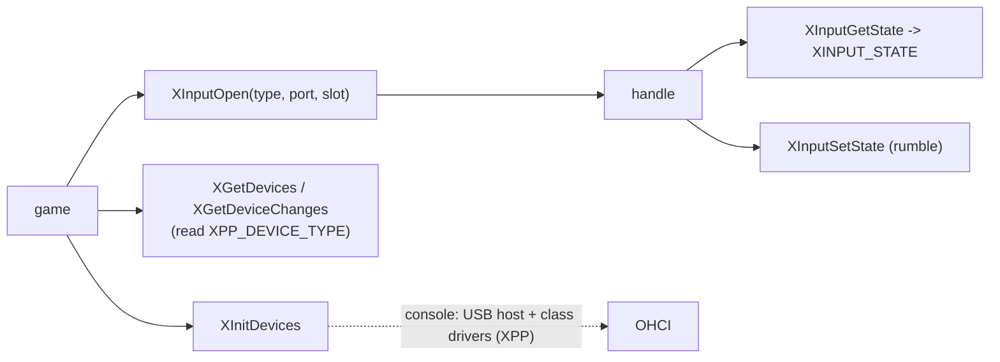

# Xbox XInput: 장치 종류, 구조체, 오류 코드, 키보드 대응

Xbox의 입력 API는 XAPI(`XAPILIB`)에 정적 링크된다. 게임은 `XInitDevices`로 USB 장치 계층을 시작하고, `XGetDevices`/`XGetDeviceChanges`로 연결 상태를 보고, `XInputOpen`으로 연 핸들에서 `XInputGetState`로 상태를 읽는다. 아래 내용은 공개 XDK 문서 지식과 우리 바이너리의 lift 본문에서 왔다. 바이너리에서 확인한 것은 **확인됨**으로 표시한다([analysis: xdk-symbols §3](../analysis/xdk-symbols.md)).

Xbox input is statically linked through XAPI (`XAPILIB`). A title starts the USB device layer with `XInitDevices`, watches connections with `XGetDevices`/`XGetDeviceChanges`, and reads state with `XInputGetState` from handles opened with `XInputOpen`. The content below comes from public XDK documentation knowledge and the lifted bodies in our binary; what was confirmed on the binary is marked **confirmed** ([analysis: xdk-symbols §3](../analysis/xdk-symbols.md)).

## 1. 장치 종류 / Device types

장치 종류는 XAPI 전역 변수의 **주소**다: `XDEVICE_TYPE_GAMEPAD` = `&g_DeviceType_Gamepad`, `XDEVICE_TYPE_MEMORY_UNIT` = `&g_DeviceType_MU`, 키보드, IR 동글도 같다. 변수는 `XPP_DEVICE_TYPE` 구조체다.

A device type is the **address** of an XAPI global: `XDEVICE_TYPE_GAMEPAD` = `&g_DeviceType_Gamepad`, `XDEVICE_TYPE_MEMORY_UNIT` = `&g_DeviceType_MU`, likewise keyboard and IR dongle. The globals are `XPP_DEVICE_TYPE` structures.

| `XPP_DEVICE_TYPE` | 의미 / Meaning |
|---|---|
| +0x0 `CurrentConnected` | 포트별 연결 비트 / connected bit per port |
| +0x4 `ChangeConnected` | 마지막 조회 뒤 바뀐 비트 / bits changed since the last query |
| +0x8 `PreviousConnected` | 마지막 조회 때의 연결 / connections at the last query |

* **확인됨**: `XGetDevices(type)`는 `Current`를 반환하고 `Change = 0`, `Previous = Current`로 쓴다. `XGetDeviceChanges(type, pIns, pRem)`는 `Change == 0`이면 둘 다 0, 아니면 `ins = Current & ~Previous | (Change & Previous & Current)`, `rem = ~Current & Previous | (Change & Previous & Current)`를 쓰고 `Change = 0`, `Previous = Current`. 둘 다 IRQL을 올린 채 구조체만 다룬다.
* **Confirmed**: `XGetDevices(type)` returns `Current` and writes `Change = 0`, `Previous = Current`; `XGetDeviceChanges(type, pIns, pRem)` writes zeros when `Change == 0`, else `ins = Current & ~Previous | (Change & Previous & Current)` and `rem = ~Current & Previous | (Change & Previous & Current)`, then `Change = 0`, `Previous = Current`. Both only touch the structure at raised IRQL.

## 2. 구조체 / Structures (추정 / inferred)

| 구조체 / Structure | 레이아웃 / Layout |
|---|---|
| `XINPUT_GAMEPAD` (18 B) | `WORD wButtons` +0; `BYTE bAnalogButtons[8]` +2 (A, B, X, Y, Black, White, Left trigger, Right trigger); `SHORT sThumbLX` +0xA, `sThumbLY` +0xC, `sThumbRX` +0xE, `sThumbRY` +0x10 (+Y up) |
| `XINPUT_STATE` (22 B) | `DWORD dwPacketNumber` +0; `XINPUT_GAMEPAD Gamepad` +4 |
| `XINPUT_CAPABILITIES` | `BYTE SubType` +0; `WORD Reserved` +2; `XINPUT_GAMEPAD In` +4; `XINPUT_RUMBLE Out` +0x16 (`wLeftMotorSpeed`, `wRightMotorSpeed`) |
| `XINPUT_FEEDBACK_HEADER` | `DWORD dwStatus` +0; `HANDLE hEvent` +4; reserved |

* **확인됨**: 원본 `XInputGetState`는 상태의 처음 DWORD에 장치 객체의 패킷 번호를 쓰고 그 뒤에 보고서를 복사하며, 연결되지 않은 장치에는 `0x48F`를 돌려준다.
* **Confirmed**: the original `XInputGetState` writes the device object's packet number to the first DWORD and copies the report after it, returning `0x48F` for a disconnected device.

`wButtons`: `DPAD_UP 0x01`, `DPAD_DOWN 0x02`, `DPAD_LEFT 0x04`, `DPAD_RIGHT 0x08`, `START 0x10`, `BACK 0x20`, `LEFT_THUMB 0x40`, `RIGHT_THUMB 0x80`. `SubType`: `XINPUT_DEVSUBTYPE_GC_GAMEPAD = 1`.

## 3. 오류 코드 / Error codes

| 이름 / Name | 값 / Value |
|---|---|
| `ERROR_SUCCESS` | `0` |
| `ERROR_INVALID_PARAMETER` | `0x57` |
| `ERROR_IO_PENDING` | `0x3E5` |
| `ERROR_DEVICE_NOT_CONNECTED` | `0x48F` |

## 4. reJSRF의 호스트 대응 / reJSRF host mapping

SDL3 게임패드(Xbox 형태)를 그대로 대응하며 Black/White는 왼쪽·오른쪽 숄더다. 호스트 게임패드가 없으면 포트 0은 키보드다.

SDL3 gamepads (Xbox-shaped) map directly, with Black/White on the left and right shoulders. Without a host gamepad, port 0 is the keyboard:

| Xbox | 키보드 / Keyboard |
|---|---|
| D-pad, 왼쪽 스틱 / left stick | 방향키 / arrow keys |
| START / BACK | Enter / Backspace |
| A / B / X / Y | Z / X / C / V |
| 왼쪽·오른쪽 트리거 / left, right trigger | A / S |
| Black / White | Q / W |

## 출처 / Sources

* 우리 바이너리의 lift 본문 `XGetDevices`(`0x001BD5FF`), `XGetDeviceChanges`(`0x001BD621`), `XInputGetState`(`0x001C3E14`), `XInputOpen`(`0x001C3BA1`) / lifted bodies in our binary.
* XbSymbolDatabase(MIT)의 심볼 이름과 인자 수 / symbol names and parameter counts.
* xboxrecomp `src/input/xinput_xbox.h`(MIT)의 `XINPUT_GAMEPAD` 모양 / the `XINPUT_GAMEPAD` shape.
