# From XBE to First Screen — Work in Progress 1

범위: [`c5e6236`](https://github.com/nworkers/reJSRF/commit/c5e6236a084c449ded02a5ecb156cf3730868fa1)부터 [`7fe2e90`](https://github.com/nworkers/reJSRF/commit/7fe2e9075bd239497081fb7abf5e35041b750c3c)까지 (최초 커밋 → v0.0.12, 그리고 창 조작 issue #31)

reJSRF는 Xbox 게임 Jet Set Radio Future(JSRF)를 에뮬레이터 없이 네이티브로 실행하려는 프로젝트다. 원본 XBE의 x86 코드를 C로 옮겨(재컴파일) 호스트 컴파일러로 빌드하고, Xbox 커널과 XDK 라이브러리(D3D8, DSOUND, XAPI, XInput)는 High Level Emulation(HLE) 계층으로 대체한다. 이 글은 빈 저장소에서 시작해 재컴파일된 JSRF가 로고 시퀀스를 지나 3D 어트랙트 데모를 그리기까지의 여정을 정리한 첫 번째 진행 기록이다.

*Win32 x86 Release 빌드의 실제 창(2배, 1280x960). 제목줄은 rePIU 형식으로 버전, 빌드 구성, 빌드 일시, 렌더러, FPS를 보여 준다.*

## 주요 변경 사항

### 0. 한눈에 보기

여정은 "frontier"를 하나씩 미는 방식으로 진행했다. frontier는 부팅이 멈추는 다음 지점이다. 실행하고, 멈춘 곳의 원인을 확인하고, 그 경계를 고친 뒤 다시 실행했다. 각 단계는 GitHub issue 하나와 설계·작업 지시·작업 로그 문서로 남겼고, 릴리스마다 부팅이 어디까지 가는지를 [boot-frontier](../analysis/boot-frontier.md)에 기록했다.

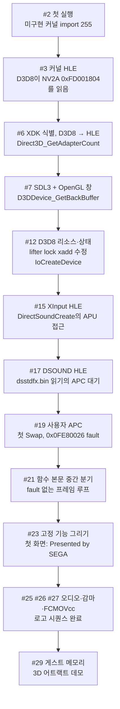

최초 커밋부터 v0.0.12까지 약 27시간이 걸렸다. 아래 차트는 릴리스마다 최초 커밋 뒤 경과 시간이다.

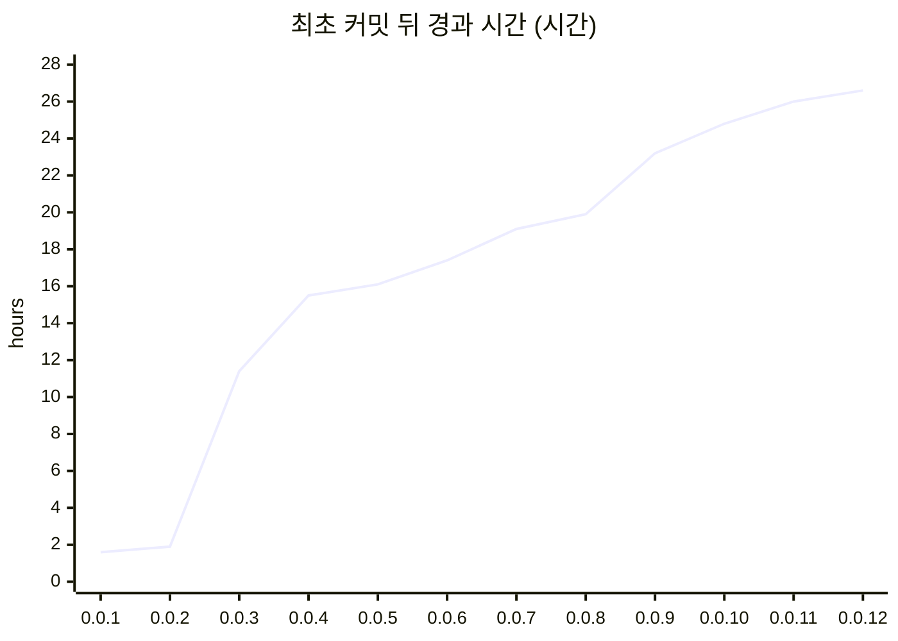

### 1. 출발점: 구조와 재컴파일 파이프라인 (v0.0.1)

첫 릴리스에서 구조를 정했다. 작업 규칙은 [rePIU](https://github.com/reexec/rePIU)의 것을 바탕으로 이 프로젝트에 맞게 고쳤다.

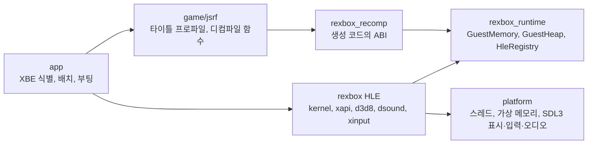

* **재컴파일**: [xboxrecomp](https://github.com/sp00nznet/xboxrecomp)가 사용자의 XBE를 C로 옮긴다. 처음에는 함수 8,721개였다. 생성 코드는 게임에서 기계적으로 만든 것이라 저장소에 넣지 않는다. `regenerate.py`가 각자의 덤프에서 다시 만든다.
* **rexbox**: 타이틀을 모르는 Xbox 런타임과 HLE 모듈이다. 게스트 코드와는 레지스터·스레드 계약으로만 만나고, 생성 코드의 ABI는 `rexbox_recomp` 한 곳에만 있다.
* **커널 HLE**: export 103개로 시작했다. 게스트 스레드마다 실제 KPCR/ETHREAD/TLS를 게스트 메모리에 만든다. 파일은 Xbox 이름공간을 호스트 폴더로 옮긴다.

첫 실행은 XAPI 초기화를 마치고, D3D8 라이브러리가 GPU 레지스터(NV2A `0xFD001804`)를 직접 읽는 곳에서 멈췄다.

### 2. HLE의 경계를 API로 옮기기 (v0.0.2 ~ v0.0.3)

D3D8 라이브러리는 게임 실행 파일 안에 정적으로 링크되어 있다. 하드웨어를 흉내 내지 않으려면 라이브러리 함수 단위로 가로채야 했다.

* [XbSymbolDatabase](https://github.com/Cxbx-Reloaded/XbSymbolDatabase)(MIT)로 XBE 안의 XDK 함수 363개를 식별했다. `regenerate.py`가 D3D8 함수 136개마다 override를 만들어, 직접 호출과 간접 호출을 모두 HLE로 보낸다.
* 구현이 없는 함수에서는 `stopped at unimplemented XDK function D3D8 <이름>`으로 멈춘다. 그래서 다음에 구현할 것이 항상 이름으로 드러났다.
* **원본과 대조하는 검증**: `rejsrf_d3d8_check`는 HLE export와 lift된 XDK 원본을 같은 게스트 상태에서 실행해 결과(eax, esp, 출력 버퍼, 라이브러리 전역)를 비교한다. 모드 목록과 Caps 같은 상수 표도 원본을 실행해 측정했다. 지금은 14,018 케이스에서 차이 0이다.
* **SDL3 + OpenGL 3.3** 호스트 계층을 플랫폼 계약(`display.h`, `input.h`, `audio.h`) 뒤에 두었다. SDL 타입은 `src/platform/sdl/` 밖으로 나오지 않는다.

### 3. 재컴파일러를 고치며 앞으로 (v0.0.4 ~ v0.0.9)

이 구간의 frontier는 대부분 재컴파일러가 원본과 다르게 옮긴 곳이었다. 하나씩 근인을 확인해 xboxrecomp를 고쳤고, 고친 것은 업스트림에 PR로 보냈다.

| 증상 | 근인 | 수정 |
|---|---|---|
| COM `Release`가 객체를 두 번 해제 | `lock xadd` 뒤 조건 분기가 플래그를 읽지 못해 항상 거짓 | lifter의 `xadd` 플래그 ([#198](https://github.com/sp00nznet/xboxrecomp/pull/198)) |
| 별칭 본문에서 스택 어긋남 | 별칭의 분기 대상이 빈 스텁으로 lift됨 | 디스어셈블러 ([#199](https://github.com/sp00nznet/xboxrecomp/pull/199)), 미해결 스텁 184 → 109 |
| 장면 노드 순회의 `0x0FE80026` fault | 다른 함수 본문 중간으로 가는 `jmp`/`jcc`가 반환 주소만 pop하는 스텁이 됨 | 본문 확정 뒤 alias 진입점 생성 ([#200](https://github.com/sp00nznet/xboxrecomp/pull/200)), 미해결 스텁 105 → 83 |
| 로고 페이드가 끝나지 않음 | x87 `FCMOVcc`가 주석으로만 남음 | 같은 조건 코드의 jcc 조건으로 lift (#198에 추가) |

마지막 사례가 이 구간의 성격을 잘 보여 준다. 게임의 float min/max 도우미가 `fcom; fnstsw; test ah, 1; fcmove`로 되어 있었는데, `fcmove`가 사라져 `min(x, 1.0)`이 항상 1, `max(x, 0.0)`이 항상 0을 돌려줬다. 페이드 색은 매 프레임 1/120씩 오른 뒤 다시 0이 되었고, 로고는 끝나지 않았다. 게임 전체에서 이 명령은 두 곳뿐이었다.

놓친 함수도 채웠다. 프롤로그 없이 시작하는 XPP 드라이버 함수 9개, 데이터나 즉시값으로만 참조되는 함수(스레드 루틴, vtable 슬롯) 162개를 seed로 넣었다. lift 함수는 9,193개가 되었다.

같은 구간에 XInput(SDL3 게임패드와 키보드), DSOUND(50개 함수, PCM과 Xbox ADPCM 믹서), 커널의 사용자 APC(I/O 완료 루틴, 경고 가능 대기)를 넣었다. v0.0.9에서 부팅은 처음으로 fault 없이 프레임 루프를 계속 돌았다. 그러나 창은 아직 검었다.

### 4. 첫 화면 (v0.0.10)

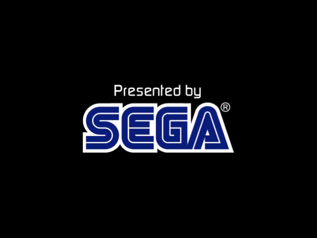

D3D8 고정 기능 그리기를 GL로 옮겼다. FVF 정점과 인덱스를 게스트 메모리에서 읽고, 텍스처는 CPU에서 RGBA8로 푼다(Morton 스위즐, DXT1/3/5). 텍스처 스테이지 상태는 GLSL로 바꾼다. 백버퍼와 깊이 버퍼는 FBO이고, `Swap`이 창으로 blit한다.

그런데 첫 frame dump는 검었다. 원인은 둘이었다.

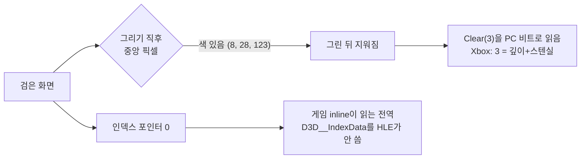

1. **인덱스 포인터가 0이었다.** 게임에 inline된 XDK 코드는 라이브러리 전역 `D3D__IndexData`를 읽어 인덱스 포인터로 쓴다. HLE `SetIndices`가 이 전역을 쓰지 않았다. 그래서 HLE의 상태 setter가 원본과 같은 전역 칸에 쓰도록 바꿨다. 그리기는 그 배열에서 상태를 읽고, `rejsrf_d3d8_check`가 원본과 칸 단위로 비교한다.
2. **`D3DCLEAR`를 PC 비트로 읽었다.** Xbox에서는 색이 `0xF0`, 깊이가 1, 스텐실이 2다. 게임이 그리기 뒤 부르는 `Clear(3)`(깊이+스텐실)이 색까지 지우고 있었다.

둘을 고치자 "Presented by SEGA"가 나왔다. 가상 60 Hz vblank 시계로 `Swap`과 `BlockUntilVerticalBlank`를 맞춰, 프레임 루프도 실기와 같은 속도로 돈다.

### 5. 로고 시퀀스 (v0.0.11)

| | | |
|---|---|---|
|  | 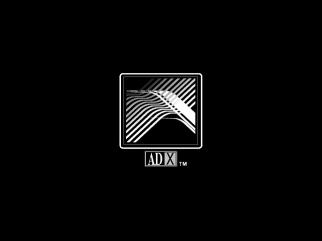 |  |

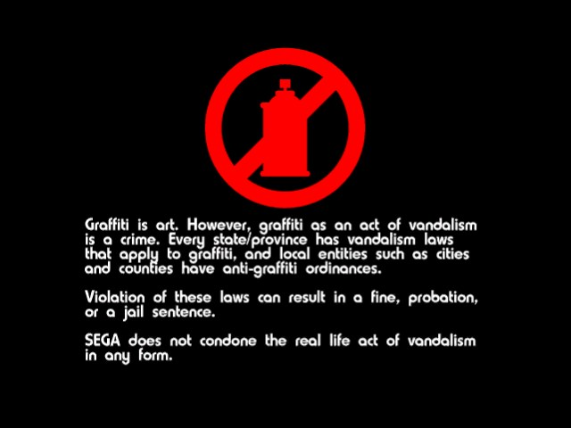

로고에서 넘어가지 않는 문제를 따라가며 세 가지를 고쳤다.

* **오디오 출력 스레드**: `rejsrf.exe`가 `/STACK:64MB`로 링크되어, 크기를 지정하지 않은 모든 호스트 스레드(오디오, SDL, GL 드라이버)가 64 MiB씩 예약했다. GL 드라이버가 먼저 올라오자 32비트 주소 공간이 바닥나 오디오 스레드가 만들어지지 않았다. `/LARGEADDRESSAWARE`로 링크하고 기본 스택을 되돌렸다. 게스트 스레드는 64 MiB 스택을 명시적으로 받는다. 같은 issue에서 프레임 스레드의 자기 일시정지(`NtSuspendThread`)도 실제로 기다리게 했다.
* **감마 램프**: 로고의 페이드는 `SetGammaRamp`로 한다. 768바이트 램프를 저장해 present와 frame dump에 GLSL 조회로 적용한다.
* **FCMOVcc**: 위 3절의 사례다. 장면 디스패처 → 작업 관리자 → 로고 작업 → 페이드 작업의 완료 플래그로 대기 사슬을 따라가, lift되지 않은 x87 조건부 이동을 찾았다.

이제 SEGA → Smilebit → ADX → Dolby Digital → 낙서 경고문이 페이드와 함께 끝까지 나온다.

### 6. 스테이지와 3D 어트랙트 데모 (v0.0.12)

| | |
|---|---|
| 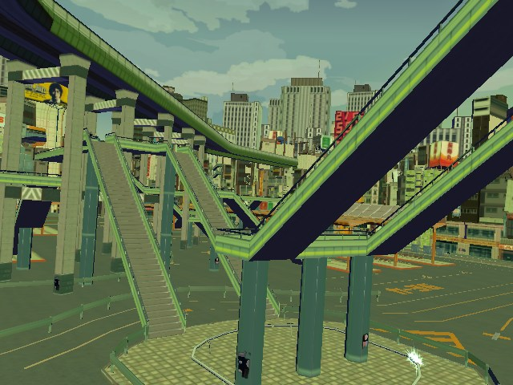 | 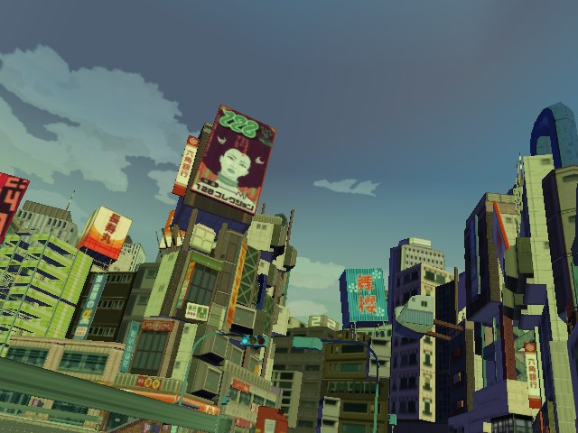 |
| 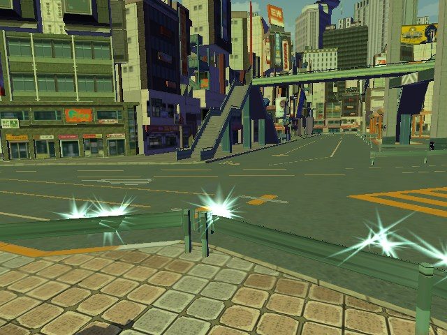 | 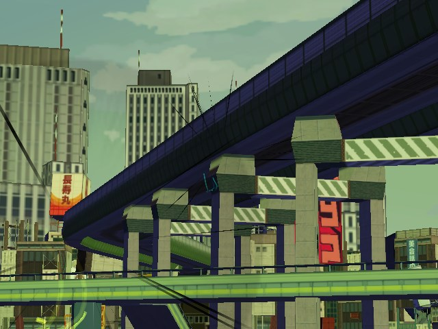 |

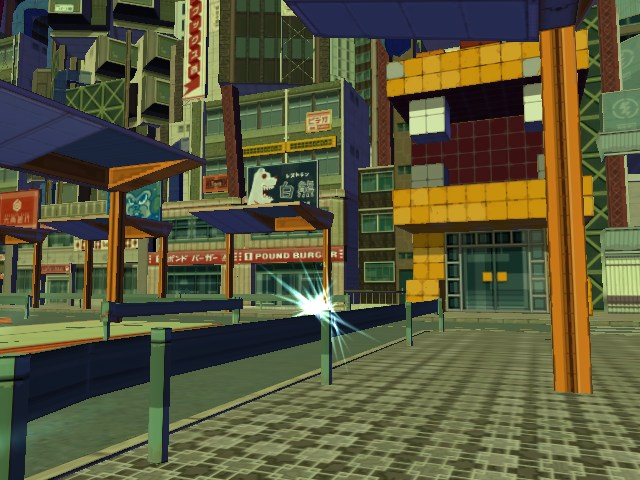

로고 다음에 스테이지를 읽다가 `NtAllocateVirtualMemory out of guest memory`로 멈췄다. 게스트 주소를 64 MiB 하나에 평면으로 매핑했기 때문에, 예약만 한 페이지도 모두 메모리를 차지했다. 낭비는 세 군데서 나왔다.

* base 0인 작은 예약 315건(합 0x5CF50바이트)이 64 KiB 할당 단위로 올림되어 약 19 MiB를 차지했다.
* 끝까지 커밋되지 않은 예약이 3.8 MiB였다.
* 수십 바이트짜리 HLE 객체가 페이지 하나씩 차지했다.

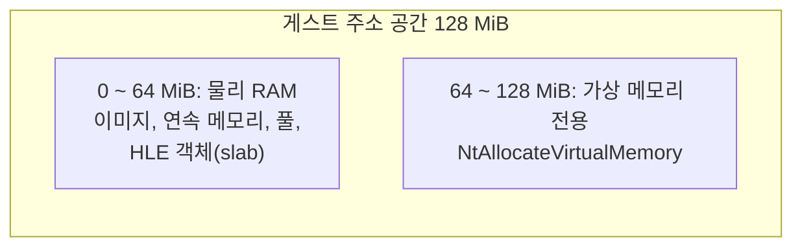

작은 예약은 페이지 단위로 정렬했다. 작은 객체는 크기 등급 slab에서 꺼낸다. 게스트 주소 공간은 128 MiB로 늘리고 위 64 MiB를 가상 메모리 전용으로 두었다. Xbox에서도 가상 메모리 주소는 물리 주소와 무관하므로 원본의 의미를 깨지 않는다. D3D가 물리 주소로 자르는 연속 메모리는 아래 64 MiB에 남는다. 이제 부팅은 스테이지를 읽고 도시 위를 나는 어트랙트 데모로 이어지며, 음악도 나온다.

### 7. 창 (issue #31)

rePIU와 같은 창 조작을 넣었다.

* 제목줄: `reJSRF v0.0.12 (Win32/x86 Release) - Build 2026-10-13 02:50 - OpenGL 3.3 - FPS : 59.0`
* 기본 크기 2배(1280x960). 종횡비를 지키며 크기를 바꾸거나 최대화할 수 있다.
* Alt+1/2/3: 1~3배 고정 배율.
* 더블클릭이나 Alt+Enter: 테두리 없는 전체화면.

### 검증 방식

화면을 보기 전에도 진척을 숫자로 확인할 수 있도록 도구를 먼저 만들었다.

| 도구 | 하는 일 | 현재 |
|---|---|---|
| `rejsrf_d3d8_check` | HLE export와 lift된 XDK 원본을 같은 상태에서 실행해 비교 | 14,018 케이스, 차이 0 |
| `rexbox_kernel_probe` | 게임 없이 커널 export 검사(동기화, APC, 메모리, 힙) | 56/56 |
| `rexbox_d3d8_probe` | 텍스처 포맷, FVF, 고정 기능 GLSL(게임·GPU 불필요) | 81/81 |
| `rexbox_dsound_probe` | DSOUND 버퍼 의미와 믹서 | 48/48 |
| `check_hle_pops.py` | HLE export의 스택 pop과 원본 `ret n` 대조 | 불일치 0 |
| `REXBOX_DISPLAY=hidden` + `REXBOX_FRAME_DUMP` | 창 없이 n번째 present를 BMP로 | 이 글의 스크린샷 |

멈춤과 손상을 추적하는 진단도 함께 늘었다. `REXBOX_HLE_TRACE`, `REXBOX_TRACE_MEMORY`, `REXBOX_WATCHDOG`(+ 게스트 RAM 덤프), `REXBOX_HEAP_CHECK`, 직접 호출 프로파일, ABI 검사 빌드(`REJSRF_RECOMP_ABI_CHECK`)가 있다.

### 현재 한계

* **캐릭터가 보이지 않는다.** 어트랙트 데모에 스케이터가 있어야 하지만, 정점 셰이더 프로그램으로 그리는 draw(`DrawIndexedVertices with a vertex-shader program`)는 아직 그리지 않는다. 스프레이 궤적과 불꽃 같은 효과만 보인다. 다음 큰 묶음은 프로그래머블 정점 셰이더(부팅 중 154개 생성)와 레지스터 컴바이너 픽셀 셰이더다.
* 고정 기능 조명, `Begin`/`End` 즉시 모드, 텍스처 변환과 좌표 생성이 아직 없다.
* 데모 중 한 구간(약 3,600번째 present)이 검게 나온다. 장면 전환인지, 그리지 못하는 경로 탓인지는 아직 모른다.
* 음악은 나오지만, 효과음 버퍼는 데모 중 `Play`가 불리지 않았다. 실제 플레이에서 확인해야 한다.
* xboxrecomp 업스트림 PR 세 개(#198, #199, #200)가 머지될 때까지 submodule은 포크의 `rejsrf` 브랜치를 가리킨다.

## 사용된 기술 스택

* **언어와 빌드**: C++20, CMake, MSVC(Win32 x86 먼저), GitHub Actions CI(Debug·Release, 게임 데이터 없이)
* **재컴파일**: [xboxrecomp](https://github.com/sp00nznet/xboxrecomp)(Python, Capstone 기반 디스어셈블러와 C lifter). 생성 코드는 약 109만 줄, 함수 9,193개다.
* **XDK 식별**: [XbSymbolDatabase](https://github.com/Cxbx-Reloaded/XbSymbolDatabase)(MIT)
* **호스트 계층**: [SDL3](https://github.com/libsdl-org/SDL)(zlib): 창, 입력, 오디오. OpenGL 3.3 core(GLSL 330)
* **HLE**: Xbox 커널(스레드·KPCR·디스패처 객체·APC·파일·메모리), D3D8(리소스·상태·고정 기능 그리기·감마), DSOUND(믹서·효과 이미지), XInput, XAPI
* **문서**: 한국어 → 영어, Mermaid. issue마다 설계·작업 지시·작업 로그
* **참고 저장소**: [rePIU](https://github.com/reexec/rePIU)(작업 규칙, 창 조작), [re2DJ](https://github.com/reexec/re2DJ)(호스트 계층). 에뮬레이터(xemu, Cxbx-Reloaded) 소스는 통합하지 않는다.

---

# From XBE to First Screen — Work in Progress 1

Range: [`c5e6236`](https://github.com/nworkers/reJSRF/commit/c5e6236a084c449ded02a5ecb156cf3730868fa1) to [`7fe2e90`](https://github.com/nworkers/reJSRF/commit/7fe2e9075bd239497081fb7abf5e35041b750c3c) (the first commit → v0.0.12, plus the window controls of issue #31)

reJSRF aims to run the Xbox game Jet Set Radio Future (JSRF) natively, without an emulator. The original XBE's x86 code is moved to C (recompiled) and built with a host compiler. The Xbox kernel and the XDK libraries (D3D8, DSOUND, XAPI, XInput) are replaced by High Level Emulation (HLE) layers. This first progress post follows the journey from an empty repository to the recompiled JSRF drawing its logo sequence and then its 3D attract demo.

*The real window of the Win32 x86 Release build (2x, 1280x960). The title bar shows the version, build configuration, build time, renderer and FPS in rePIU's form.*

## Major Changes

### 0. At a glance

The work moved one "frontier" at a time. A frontier is the next place the boot stops. Each round was the same: run, confirm why it stopped, fix that boundary, and run again. Each step has one GitHub issue with a design, a work order and a work log. Each release records how far the boot gets in [boot-frontier](../analysis/boot-frontier.md).

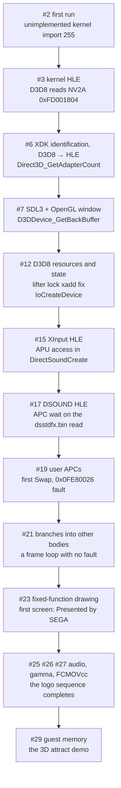

From the first commit to v0.0.12 took about 27 hours. The chart shows the hours from the first commit to each release.

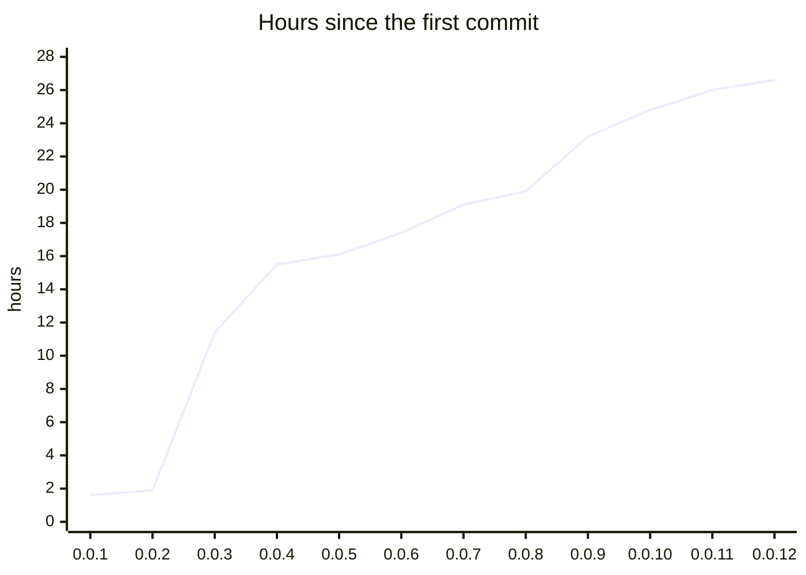

### 1. The starting point: structure and the recompilation pipeline (v0.0.1)

The first release set the structure. The working rules are [rePIU](https://github.com/reexec/rePIU)'s, adapted to this project.

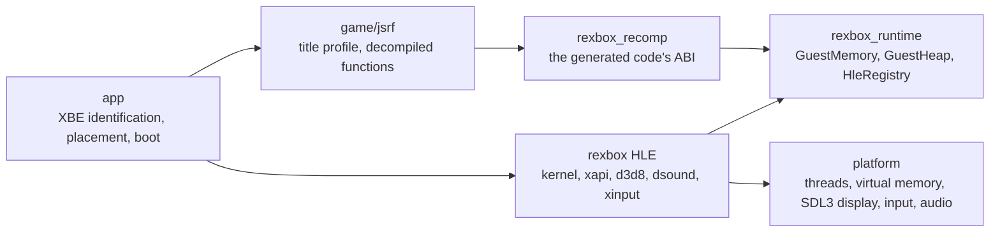

* **Recompilation.** [xboxrecomp](https://github.com/sp00nznet/xboxrecomp) moves the user's XBE to C, 8,721 functions at first. The generated code is made mechanically from the game, so it is never committed. `regenerate.py` rebuilds it from each user's own dump.
* **rexbox.** This is the title-agnostic Xbox runtime and its HLE modules. It meets guest code only through register and thread contracts, and the generated code's ABI lives only in `rexbox_recomp`.
* **Kernel HLE.** It started with 103 exports. Each guest thread gets a real KPCR/ETHREAD/TLS in guest memory, and files map the Xbox namespace onto host folders.

The first run finished XAPI initialization and stopped where the D3D8 library reads a GPU register directly (NV2A `0xFD001804`).

### 2. Moving the HLE boundary to the API (v0.0.2 – v0.0.3)

The D3D8 library is statically linked into the game executable. Avoiding hardware emulation meant intercepting it function by function.

* [XbSymbolDatabase](https://github.com/Cxbx-Reloaded/XbSymbolDatabase) (MIT) identified 363 XDK functions in the XBE. `regenerate.py` emits an override for each of 136 D3D8 functions, sending direct and indirect calls alike to the HLE.
* A function with no implementation stops the boot with `stopped at unimplemented XDK function D3D8 <name>`, so the next thing to implement was always named.
* **Verification against the original.** `rejsrf_d3d8_check` runs an HLE export and the lifted XDK original from the same guest state and compares the results: eax, esp, output buffers and library globals. Constant tables such as the mode list and the caps were measured by running the original. It now passes 14,018 cases with 0 differences.
* The **SDL3 + OpenGL 3.3** host layer sits behind platform contracts (`display.h`, `input.h`, `audio.h`). SDL types never leave `src/platform/sdl/`.

### 3. Fixing the recompiler to move forward (v0.0.4 – v0.0.9)

Most frontiers in this stretch were places where the recompiler moved code differently from the original. Each root cause was confirmed, xboxrecomp was fixed, and each fix went upstream as a PR.

| Symptom | Root cause | Fix |
|---|---|---|
| COM `Release` freed an object twice | a conditional branch after `lock xadd` could not read its flags and was always false | `xadd` flags in the lifter ([#198](https://github.com/sp00nznet/xboxrecomp/pull/198)) |
| the stack drifted in alias bodies | an alias's branch target was lifted as an empty stub | disassembler ([#199](https://github.com/sp00nznet/xboxrecomp/pull/199)); unresolved stubs 184 → 109 |
| a `0x0FE80026` fault in the scene-node walk | `jmp`/`jcc` into the middle of another function's body became a stub that only popped the return address | alias entry points once bodies are final ([#200](https://github.com/sp00nznet/xboxrecomp/pull/200)); unresolved stubs 105 → 83 |
| the logo fade never completed | x87 `FCMOVcc` was left as a comment | lifted with the condition of the jcc that has the same condition code (added to #198) |

The last case shows this stretch well. The game's float min/max helpers are `fcom; fnstsw; test ah, 1; fcmove`. With the `fcmove` gone, `min(x, 1.0)` always returned 1 and `max(x, 0.0)` always returned 0. The fade color rose by 1/120 each frame and fell back to 0, so the logo never ended. The whole game has only two such instructions.

Missed functions were filled in too: 9 XPP driver functions that start without a prologue, and 162 functions referenced only from data or immediates (thread routines, vtable slots) were seeded. Lifted functions reached 9,193.

The same stretch added XInput (SDL3 gamepad and keyboard), DSOUND (50 functions, a mixer for PCM and Xbox ADPCM) and kernel user APCs (I/O completion routines, alertable waits). In v0.0.9 the boot first kept its frame loop running with no fault. The window was still black.

### 4. The first screen (v0.0.10)

D3D8 fixed-function drawing moved to GL. FVF vertices and indices are read from guest memory, and textures are unpacked to RGBA8 on the CPU (Morton swizzle, DXT1/3/5). Texture-stage state becomes GLSL. The back buffer and depth buffer are FBOs, and `Swap` blits to the window.

The first frame dump was still black, for two reasons.

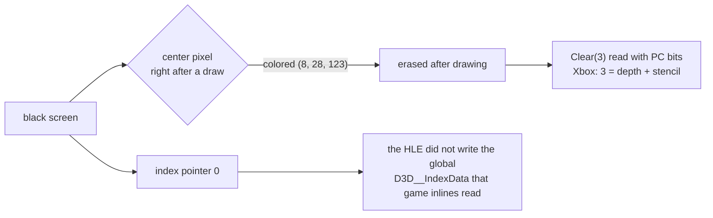

1. **The index pointer was 0.** XDK code inlined into the game reads the library global `D3D__IndexData` as the index pointer, and the HLE `SetIndices` did not write it. The HLE state setters now write the same global slots as the original. Drawing reads its state from those arrays, and `rejsrf_d3d8_check` compares them slot by slot with the original.
2. **`D3DCLEAR` was read with PC bits.** On the Xbox, color is `0xF0`, depth 1 and stencil 2. The `Clear(3)` (depth + stencil) that the game calls after drawing was erasing the color too.

With both fixed, "Presented by SEGA" appeared. A virtual 60 Hz vblank clock paces `Swap` and `BlockUntilVerticalBlank`, so the frame loop runs at the console's speed.

### 5. The logo sequence (v0.0.11)

| | | |
|---|---|---|
|  |  |  |

Following why the boot stayed on the logo led to three fixes.

* **The audio output thread.** `rejsrf.exe` was linked with `/STACK:64MB`, so every host thread created without a stack size (audio, SDL, the GL driver) reserved 64 MiB. Once the GL driver loaded first, the 32-bit address space ran out and the audio thread could not be created. The exe now links with `/LARGEADDRESSAWARE` and the default stack, and guest threads get their 64 MiB stacks explicitly. The same issue made the frame thread's self-suspension (`NtSuspendThread`) actually wait.
* **The gamma ramp.** The logos fade through `SetGammaRamp`. The 768-byte ramp is stored and applied to the present and to frame dumps with a GLSL lookup.
* **FCMOVcc.** This is the case from section 3. The wait chain ran from the scene dispatcher to the task manager, the logo task and the fade task's done flag, and ended at the unlifted x87 conditional move.

Now SEGA → Smilebit → ADX → Dolby Digital → the anti-graffiti notice run to the end with their fades.

### 6. The stage and the 3D attract demo (v0.0.12)

| | |
|---|---|
|  |  |
|  |  |

After the logos, loading the stage stopped with `NtAllocateVirtualMemory out of guest memory`. Guest addresses were mapped flat onto a single 64 MiB block, so even reserved-only pages took memory. The waste came from three places:

* 315 small base-0 reservations (0x5CF50 bytes in total) were rounded to the 64 KiB allocation granularity and took about 19 MiB.
* 3.8 MiB of reservations were never committed.
* HLE objects of a few dozen bytes took a page each.

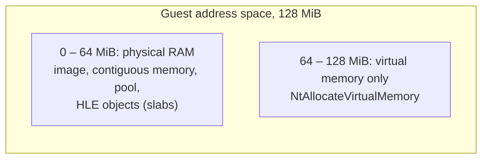

Small reservations are now page aligned, and small objects come from size-class slabs. The guest address space grew to 128 MiB, with the upper 64 MiB for virtual memory only. On the Xbox too, virtual memory addresses have nothing to do with physical ones, so this keeps the original's meaning. Contiguous memory, which D3D cuts to physical addresses, stays in the low 64 MiB. The boot now loads the stage and goes on into the attract demo's flight over the city, with music.

### 7. The window (issue #31)

The window got rePIU's controls:

* The title bar: `reJSRF v0.0.12 (Win32/x86 Release) - Build 2026-10-13 02:50 - OpenGL 3.3 - FPS : 59.0`.
* A 2x default size (1280x960). It resizes and maximizes with its aspect ratio kept.
* Alt+1/2/3: fixed 1x–3x scales.
* A double click or Alt+Enter: borderless fullscreen.

### How it is verified

Tools came first, so progress could be measured before anything showed on screen.

| Tool | What it does | Now |
|---|---|---|
| `rejsrf_d3d8_check` | runs HLE exports and the lifted XDK originals from the same state and compares | 14,018 cases, 0 differences |
| `rexbox_kernel_probe` | checks kernel exports without the game (sync, APCs, memory, heap) | 56/56 |
| `rexbox_d3d8_probe` | texture formats, FVF, fixed-function GLSL (no game or GPU) | 81/81 |
| `rexbox_dsound_probe` | DSOUND buffer semantics and the mixer | 48/48 |
| `check_hle_pops.py` | matches HLE exports' stack pops against the originals' `ret n` | 0 mismatches |
| `REXBOX_DISPLAY=hidden` + `REXBOX_FRAME_DUMP` | the n-th present as a BMP, without a window | this post's screenshots |

Diagnostics for hangs and corruption grew alongside: `REXBOX_HLE_TRACE`, `REXBOX_TRACE_MEMORY`, `REXBOX_WATCHDOG` (with a guest RAM dump), `REXBOX_HEAP_CHECK`, a direct-call profile, and an ABI-check build (`REJSRF_RECOMP_ABI_CHECK`).

### Current limits

* **No characters yet.** The attract demo should show skaters, but draws with a vertex-shader program (`DrawIndexedVertices with a vertex-shader program`) are not drawn yet. Only effects such as spray trails and sparks show. The next large batch is programmable vertex shaders (154 created during boot) and register-combiner pixel shaders.
* Fixed-function lighting, `Begin`/`End` immediate mode, and texture transforms and coordinate generation are still missing.
* One stretch of the demo (around the 3,600th present) is black. Whether it is a scene transition or a path not drawn yet is not known.
* Music plays, but no `Play` was called on the sound-effect buffers during the demo. This needs checking in real play.
* Until three upstream xboxrecomp PRs (#198, #199, #200) are merged, the submodule points at the fork's `rejsrf` branch.

## Technology Stack Used

* **Language and build**: C++20, CMake, MSVC (Win32 x86 first), GitHub Actions CI (Debug and Release, without game data)
* **Recompilation**: [xboxrecomp](https://github.com/sp00nznet/xboxrecomp) (Python, a Capstone-based disassembler and C lifter). The generated code is about 1.09 million lines, 9,193 functions.
* **XDK identification**: [XbSymbolDatabase](https://github.com/Cxbx-Reloaded/XbSymbolDatabase) (MIT)
* **Host layer**: [SDL3](https://github.com/libsdl-org/SDL) (zlib) for the window, input and audio; OpenGL 3.3 core (GLSL 330)
* **HLE**:
  * Xbox kernel: threads, KPCR, dispatcher objects, APCs, files, memory
  * D3D8: resources, state, fixed-function drawing, gamma
  * DSOUND: the mixer and the effects image
  * XInput and XAPI
* **Documentation**: Korean then English, with Mermaid diagrams. Every issue has a design, a work order and a work log.
* **Reference repositories**: [rePIU](https://github.com/reexec/rePIU) for the working rules and window controls, [re2DJ](https://github.com/reexec/re2DJ) for the host layer. Emulator source (xemu, Cxbx-Reloaded) is never integrated.
